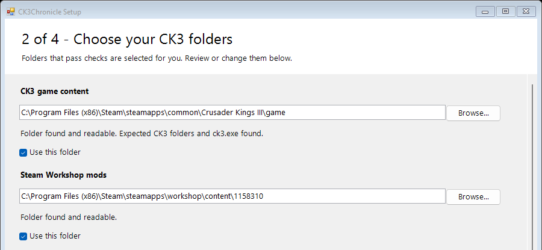

# Installation and launch

Application **0.0.3**, Windows x64. Setup connects ck3chronicle to your game and
chooses where to keep settings and diagnostic history. Start observation after
setup to protect the output of your next CK3 session.

## Verify and extract the bundle

Obtain the whole versioned ZIP and its separately supplied SHA-256 receipt.
Compare that hash, then extract to a new folder of your choice. Keep its CMD
files, runtime, tools, docs, notices and manifest together. From PowerShell in
that folder, run:

```powershell
.\Verify.cmd
.\Setup.cmd
```

`Verify.cmd` checks files against the included manifest; it does not provide an
independent signature of origin. The bundle supplies Python, chardet, ripgrep
and model/Learner resources. The wizard uses Windows PowerShell 5.1 and the
Windows .NET Framework desktop components. CK3 and its readable logs directory
must already exist; a current `error.log` is optional at setup.

## Choose folders and save settings

Double-clicking `Setup.cmd` also opens the wizard. It has four numbered steps
followed by a completion screen. Use Back/Next to review your choices.

1. **Application and settings.** Check the displayed application folder and
   choose a settings folder. The wizard supplies the `paths.toml` filename.
   Settings normally go to `%LOCALAPPDATA%\ck3chronicle\paths.toml`.
2. **CK3 folders.** Inspect the game `game` folder, Workshop `content\1158310`,
   local mods, live logs and crashes locations. Use Browse or type full paths.
   Each folder has findings and a **Use this folder** checkbox. Healthy
   suggestions are selected by default. Review and confirm missing or suspicious
   locations; required game/log directory errors block continuation. Optional
   mod/crash locations can produce warnings. Setup reads external folders and
   does not create missing CK3 folders.
3. **Storage and model.** Choose a writable data location separate from the
   application and CK3/mod sources. The default is
   `%LOCALAPPDATA%\ck3chronicle\data`, with separate runtime and Learner trees.
   The model dropdown shows authenticated available packages and marks the
   current or recommended choice. Details shows its exact package and manifest
   identities. This choice governs new processing; stored Runs keep their lineage.
4. **Review and save.** Review all settings, then choose **Save settings**.
   This initializes storage as needed and saves the exact database filename.
   Earlier steps do not save. Cancel before saving exits 130 and leaves settings
   unchanged. During checking/saving, navigation and closing are temporarily
   disabled to avoid an ambiguous interrupted save.



This screenshot is cropped to show folder-selection controls and hide private
paths. Review the local-mod, logs and crashes fields below the crop as well.
Changing a path clears its old selection until **Next** or **Check folders**
rechecks it. A healthy edited path is selected automatically. A deliberately
unselected, unchanged folder stays unselected; Next identifies it for review.
The final Save confirms the displayed choices.

On Finish, keep the configuration and database paths and the copyable commands.
Expected results are saved settings, an initialized database and an authenticated
model selection. **Check saved settings** runs the read-only doctor. It normally
exits 2 because write access remains *unverified* by that read-only check; read
the individual findings before concluding that setup failed. Correct required
path or model errors using their stated actions. Details retains findings/effects.

## Choose explicit locations or use text setup

For a settings file or data folder of your choice:

```powershell
.\Setup.cmd --config 'D:\Chronicle\settings\paths.toml' --data-root 'D:\Chronicle\data'
```

Locations fixed by these arguments appear as text in the wizard. Use that same
`--config` on later commands. Omitting it always selects
`%LOCALAPPDATA%\ck3chronicle\paths.toml`; there is no remembered bundle-local
override. Relative command arguments resolve from the terminal's working
directory; relative paths inside TOML resolve beside that TOML file.

`Setup-Text.cmd` accepts the same options, using terminal Use/Change/Cancel
questions and an explicit final Apply. The [CLI setup reference](CLI_REFERENCE.md#setup)
describes preview, explicit path acceptance and JSON results.

## Start and stop

Start observation with your saved configuration, leave its terminal open, then
launch CK3 in your usual way. The watcher normally waits quietly for the configured
process. Start before CK3 so it can observe the session's start and exit.

```powershell
.\Start.cmd --config 'D:\Chronicle\settings\paths.toml'
```

Starting can submit retained pending captures for processing. Raw-log retention
runs on its configured maintenance schedule; it can remove eligible captured logs
independently of ingestion success. By default their retention period is 30 days.
See [processing and retention](CONFIGURATION_REFERENCE.md#automatic-processing-and-raw-log-retention).

Press **Ctrl+C in the watcher's terminal** and wait for the command to return.
This stops observation; CK3 and the database handler have independent lifetimes.
Before changing settings, selecting a model or replacing application files,
also stop that setup's handler:

```powershell
.\ck3chronicle.cmd --config 'D:\Chronicle\settings\paths.toml' runtime-stop
```

`runtime-stop` refuses while the watcher holds its lease. Shutdown can reject
unfinished requests; check their results and stored Runs. A later report or
request can start a handler again. If Ctrl+C fails to return, retain the logs
and avoid changing that runtime's settings; see [Troubleshooting](TROUBLESHOOTING.md).

## Optional startup at Windows sign-in

After completing setup and checking a normal launch, you can ask Windows to
start the foreground watcher when you sign in:

1. Create a shortcut to `Start.cmd` in your extracted application folder.
2. In the shortcut's Properties, set **Target** to the full quoted launcher path,
   followed by `--config` and the full quoted settings path when using a custom
   configuration. For example:
   `"D:\Apps\ck3chronicle\Start.cmd" --config "D:\Chronicle\settings\paths.toml"`.
   Set **Start in** to the extracted application folder.
3. Press **Win+R**, enter `shell:startup`, and place the shortcut in that folder.
   Windows starts it on your next sign-in. Keep the watcher's terminal open.

Use the same stop sequence above. Remove this shortcut to stop future automatic
launches. Update it if you move the bundle. This uses Windows' current-user
[Startup folder](https://support.microsoft.com/en-us/windows/experience/startup-boot/configure-startup-applications-in-windows).

## Revisit settings, move the application or recover a save

For an existing setup, stop its watcher and handler first, then run Setup with
the same configuration. A fresh setup with separate data is independent of
another setup. Review and save only intended changes. Repeat setup preserves
the database, captures, review evidence, selected model and unrelated settings;
it rewrites TOML formatting/comments. Setup is not a data-move tool. Moving
application files leaves data in its configured location; rerun setup to update
the bundled ripgrep path.

A save failure can leave reported effects. Keep its returned database path and
inspect those effects before retrying. If initialization succeeded before saving
settings failed, retry using that exact file with `.\Setup.cmd --config 'FULL PATH'
--database 'EXACT RETURNED FILE'` and the same roots. Do not delete the data
directory or guess another database. [Troubleshooting](TROUBLESHOOTING.md)
explains interrupted setup and locks.

Launcher failures exit 1; application commands retain their own exit codes.
Removing the extracted application folder leaves separately stored history in
place. Preserve data you still need, including native review files and captures.

[Continue to Everyday workflows](WORKFLOWS.md) · [Manual contents](README.md)
