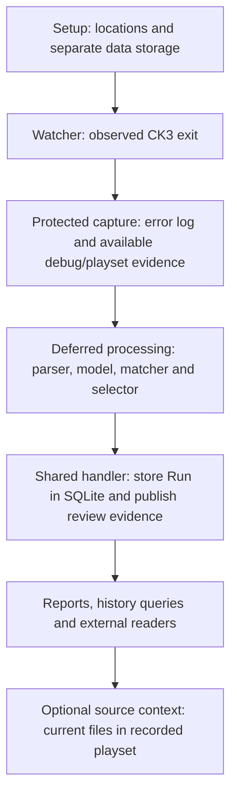

# Orientation to ck3chronicle

[Manual contents](README.md) · [Previous: Introduction](INTRODUCTION.md)

A **Run** is a completed CK3 session whose evidence you want to investigate.
ck3chronicle first protects that evidence, then processes it into stored results.
Reports let you explore those results and compare them with earlier Runs.

Use [Terms at a glance](#terms-at-a-glance) to look up an unfamiliar term.

## From CK3 exit to a report

Capture protects the input first. Processing then interprets it, and stored
history supports later investigations. Current source context adds information
from files on disk when you ask for it.

1. **Choose the locations.** Setup saves one paths configuration. Later commands
   use that exact file when you supply `--config`, or the fixed default location
   when you omit it. Your chosen data directory holds the application's working
   evidence separately from the game and mods.
2. **Observe a session.** Start the watcher before launching CK3. Automatic
   lifecycle capture requires it to observe the configured process start and
   exit. Merely finding a log file does not establish an observed session.
3. **Protect the logs.** After exit, the watcher copies the live `error.log` into
   protected pending storage before classification begins. It also attempts to
   preserve the live `debug.log`, from which it extracts the ordered active
   playset. A **Capture ID** identifies this protected input. Missing evidence
   remains explicitly unavailable. Capture metadata also retains observed
   lifecycle facts and any associated crash evidence; an associated crash
   folder can supply its root `exception.txt`, while principal logs come from
   the live log directory.
4. **Process the capture.** With automatic ingestion enabled, the protected
   error log is submitted for validation and classification. A full-file hash
   detects an identical file already stored as a Run. Submitting that same file
   again returns the existing identity instead of adding a second Run.
5. **Store the result.** Successful ingestion assigns a **Run ID**, stores
   recognized diagnostics and their occurrence counts in SQLite, and finalizes
   the Run's native review files. A capture can exist before processing succeeds;
   a Capture ID and a Run ID identify different stages.
6. **Investigate.** Select a stored Run, read or filter its diagnostics, compare
   available history, and add source context as needed. Reports render stored
   diagnostics from SQLite. Looking up source context reads current game or mod
   files separately.

The [everyday workflows](WORKFLOWS.md) cover this journey and the explicit
capture/ingestion route for existing logs. Startup can also submit retained
pending captures, so launching the watcher may begin processing before a new
CK3 session starts.

### Starting observation

For manual launch, open `Start.cmd` after setup and before launching CK3. It
starts observation; you launch and play CK3 in the usual way. If you prefer
observation to begin when you sign in to Windows, startup automation is a
separate user-configured Windows choice that invokes the same launcher with
the same saved configuration. Setup saves application settings; it leaves that
Windows startup choice to you. Keep the selected configuration explicit when
using a location other than the default. See
[Installation and launch](INSTALLATION.md) for the launch/configuration contract.

The watcher and database handler have separate lifetimes. Stopping the
foreground watcher ends observation; the handler can remain available to other
application clients. Installation explains stopping the watcher with Ctrl+C and
explicitly stopping the handler before changing settings or application files.

## The parts you work with

| Component | Its job |
|---|---|
| Watcher and capture | Observe the configured CK3 process, protect logs after exit, and retain available lifecycle/playset/crash facts. Trigger enabled ingestion and scheduled raw-log retention. |
| Parser | Recognize log emissions and recover message pieces and their surrounding/supporting structure, preserving where they came from. |
| Templates and model | Describe recurring message shapes, literal text, supported value slots and their constraints, learned from observed evidence. |
| Matcher | Check a recovered message against the published definitions, validating its wording, values, context and required supporting entries. |
| Selector | Resolve the complete matching assignments according to the packaged rules, yielding one selected assignment and its match status, or leaving the evidence unresolved. |
| Handler and database | Queue application requests and serialize database work, storing Run metadata, playset context, diagnostic definitions, values and counts. |
| Native review evidence | Preserve unresolved or unassigned native material beside the database, with a per-Run metadata manifest. |
| Report and query tools | Render stored diagnostic text, filter results, compare available Run history and export text, JSON or offline HTML. |
| Source-context tools | Use recorded playset references or explicitly chosen roots to find current candidate files, search content and show excerpts. |
| Retained Learner | Let advanced maintainers learn and evaluate models from protected logs using an identified implementation. Ordinary users can start with the supplied model. |

One handler per database feeds **one request queue and one serial database
worker**. Several application clients can submit requests concurrently; their
database operations take turns. External read-only tools can read while this
single writer is active. Keep read transactions short, close them promptly and
retry later if SQLite reports busy or locked. Long reads can delay the writer.
The [external data guide](EXTERNAL_DATA.md#connection-and-writer-conditions)
explains read-only connections, locking and live-file-copy precautions.

## What a stored Run contains

Think of a Run as three related groups of information:

| Group | What you can learn from it |
|---|---|
| Run metadata, context and processing lineage | The Run ID, source-log hash, available capture/lifecycle/crash facts, recorded playset and exact processing-resource identities. Capture time, CK3 lifecycle time and processing time have different meanings. The playset records base game, DLCs and mods in mount order, with names and source paths where available. |
| Diagnostic records with values and counts | Recognized messages, their selected template definitions and exact bound values, template/provisional match status, and occurrence counts within this Run. SQLite stores the definitions and values needed to render them. |
| Unresolved native review evidence | Native material kept in a separate review shard. SQLite records its counts, location, publication availability and integrity hash so you can find and check it. |

A **native review shard** consists of a native-text review log and a metadata
manifest for one Run. It preserves unassigned or unresolved evidence for closer
inspection, including its provenance. Use the
[external data guide](EXTERNAL_DATA.md) to inspect them directly.

The retained raw capture is the input to processing, stored separately from
SQLite. The playset records source locations; the corresponding game/mod files
also remain separate. The protected raw logs have their own retention policy.
By default, eligible captured `error.log` and `debug.log` files expire after
30 elapsed days measured from capture time, independently of ingestion success. This cleanup preserves
stored Run history and review shards. Keep an appropriate retained copy when
you need the exact original log beyond that period: the diagnostic database
contains refined results and cannot reconstruct the complete original file.
See [raw-log retention](CONFIGURATION_REFERENCE.md#automatic-processing-and-raw-log-retention)
for the controls and deletion boundaries.

## Templates and packages

A **template** describes the recurring structure of a message. Its fixed text
stays the same while named slots hold changing values, such as a key, identifier
or file location. A **binding** is a particular value associated with one of
those slots in a recognized diagnostic.

The [genuine example in the introduction](INTRODUCTION.md#why-templates-help)
shows an unknown-trigger template, a particular key and its locations. Each
different set of values remains a distinct diagnostic; repeating the same
complete diagnostic within a Run increases its occurrence count.

The identity rules also account for the selected layout and any supporting
message entries. Grouping therefore preserves distinctions that a simple
matching-word count would lose. In a report:

- **Record count** tells you how many distinct stored diagnostics were selected.
- **Occurrence count** tells you how many times those diagnostics occurred.
- **Template** and **provisional** are match statuses. Both can produce complete
  stored records; the status is neither a severity grade nor a numeric confidence
  score.
- **Unresolved evidence** remains in the review shard. An empty diagnostic query
  does not establish that the Run had no unresolved messages.

A **model package** supplies the templates together with the compatible parsing,
matching and selection components. Its **package ID** names that combination.
A **manifest pin** is the expected SHA-256 hash of the package's manifest; it
lets the application authenticate the exact package files before using them.
These pinned components make processing traceable: recorded lineage tells you
which exact reviewed model and implementations processed a Run. Retaining those
resources supports reproducing and inspecting the processing behavior.
Preserve installed package files as immutable resources.

An approved later package becomes available through the supported model
registration and application-distribution procedures. **Registration**
authenticates a package and adds it to a catalog; **active selection** is the
separate setup operation that saves your chosen available package and manifest
pin. Merely registering a package, or printing selection JSON, leaves your
saved choice unchanged. Ordinary users select from the packages available in
their installation; maintainers use a separate writable catalog when preparing
new releases. The [model inspection and selection workflow](WORKFLOWS.md#inspect-or-change-the-selected-model)
and [advanced catalog reference](RELEASE_REFERENCE.md#model-catalog-commands)
explain the corresponding operations.

Choosing another package changes future ingestion. Each stored Run keeps its
original processing lineage, and reports use those stored records. The same
message wording alone is not sufficient to establish comparable classification
identities across different packages. History queries use the applicable stored
package identity; see [report queries and results](REPORT_QUERY_REFERENCE.md)
for selection and comparison rules. [Advanced release administration](RELEASE_REFERENCE.md)
covers changing the active selection and maintaining packages.

## How source context fits

The error log supplies diagnostics. The captured debug log supplies playset
context, including the ordered locations of base-game, DLC and mod data.
ck3chronicle can use that recorded context to look for files or content on disk
and show relevant excerpts beside a diagnostic.

For a single-file/line reference, the last matching recorded playset member in
load order supplies the assigned source under the product's rule. Other
candidates and coverage remain visible. Missing files, unavailable load order
or missing lines can leave the source unassigned with an explanation. A message
without a source path is complete as recorded; source lookup does not apply to
that message.

This gives you a place to investigate, while preserving the distinction between
what CK3 reported and what you can read now. A current file may have changed
since the Run, and a source association does not prove causal responsibility.
Review the report's coverage information before treating a partial search or
history window as complete.

## Terms at a glance

| Term | Meaning |
|---|---|
| Capture ID | Identity of protected input, which can still be awaiting processing. |
| Run ID | Identity assigned after successful ingestion of a Run's evidence. |
| Emission | A recognized timestamp-prefixed log entry and any continuation lines. Processing may relate several emissions to one diagnostic. |
| Template | Recurring message structure with fixed text and typed slots. |
| Binding / value | The particular content associated with a template slot. |
| Occurrence | One instance of a diagnostic, counted with equivalent instances within the Run. |
| Playset | Captured ordered base-game, DLC and mod context for a Run. |
| Package ID | Identity of a particular model and compatible processing-component combination. |
| Manifest pin | Expected hash used to authenticate exact package contents. |
| Review shard | One Run's separate native review log and metadata manifest. |
| Handler | The application process that queues requests and serializes database work for a database. |

[Continue to Installation and launch](INSTALLATION.md) · [Manual contents](README.md)
